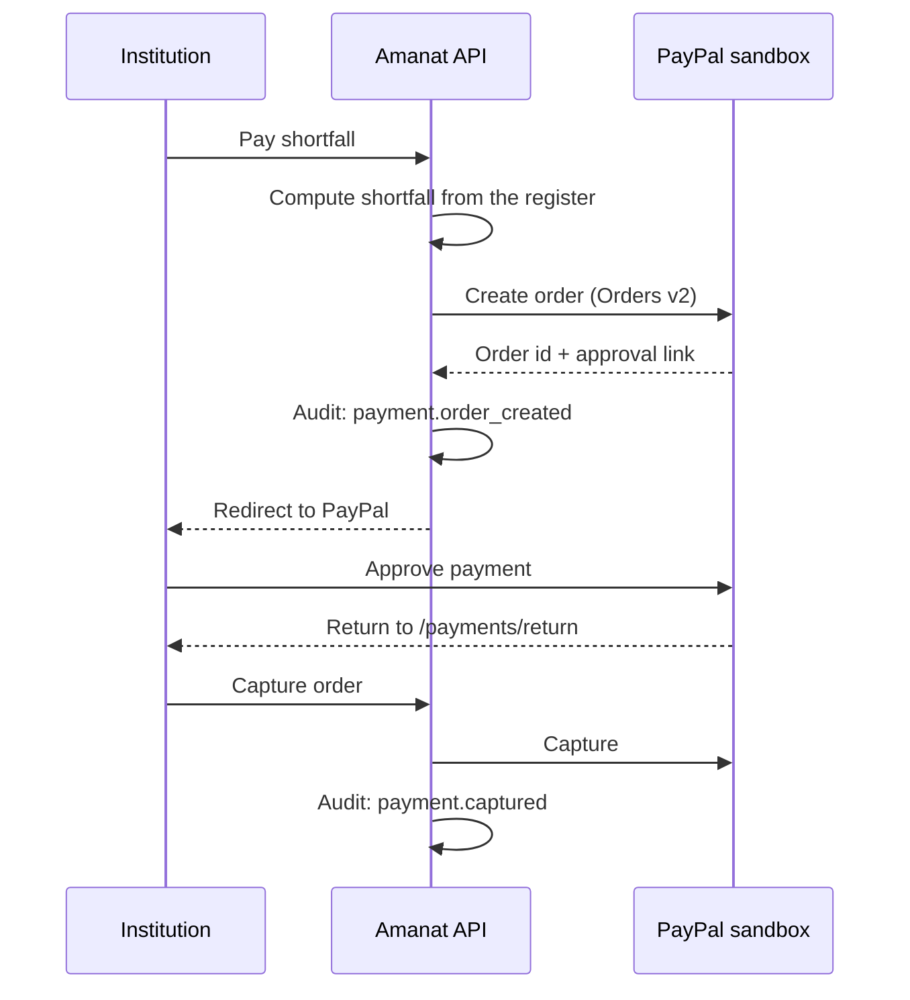
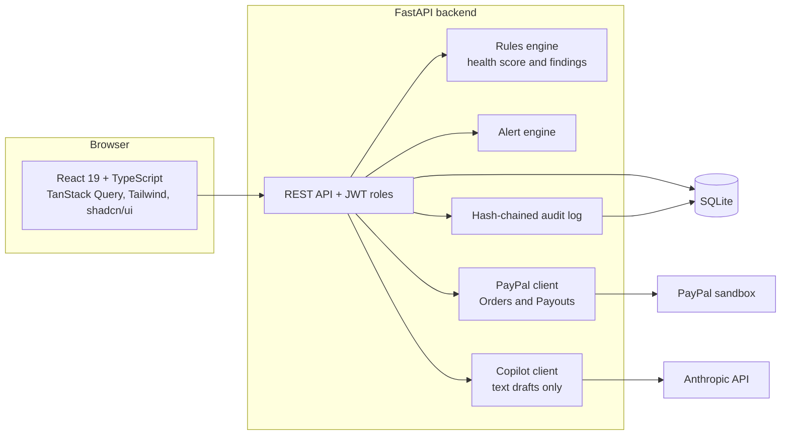

# Amanat — Tamper-proof Security Deposit & FDR Portal

*Every deposit, every deadline, on record.*


**Amanat** (Hindi/Urdu: *something held in trust*) is a portal for a regulation bureau to manage the security
deposits, usually Fixed Deposit Receipts (FDRs), that institutions lock away. It tracks every deposit from
registration to release, warns before maturities lapse, catches bad data before approval, and writes every action
into a **hash-chained audit trail that anyone can verify**.

For this hackathon we added two things on top of the core portal:

- **PayPal (sandbox):** institutions pay a deposit **shortfall** through PayPal Checkout, and the bureau sends the
  **release refund** through PayPal Payouts. Every payment and refund lands in the same tamper-evident audit trail.
- **AI Deposit Copilot (Claude):** drafts reviewer observations and plain-language explanations of deposit findings.
  It only writes text. A person reviews it and takes every action.

---

## Table of contents

1. [The problem](#the-problem)
2. [Feature overview](#feature-overview)
3. [PayPal integration](#paypal-integration)
4. [AI Deposit Copilot](#ai-deposit-copilot)
5. [How the trust layer works](#how-the-trust-layer-works)
6. [Architecture](#architecture)
7. [Roles and permissions](#roles-and-permissions)
8. [Quick start](#quick-start)
9. [Configuration](#configuration)
10. [Demo logins and demo flow](#demo-logins-and-demo-flow)
11. [Testing](#testing)
12. [Project structure](#project-structure)
13. [Security notes](#security-notes)
14. [Known limitations](#known-limitations)
15. [Troubleshooting](#troubleshooting)
16. [License](#license)

---

## The problem

A regulator can hold hundreds of deposit FDRs, each with its own bank, branch, maturity date and lien. In practice
they live in spreadsheets, file cabinets and email threads, which causes three recurring failures:

| Failure | What happens today | What Amanat does |
|---|---|---|
| Deposits lapse unnoticed | Nobody sees a maturity coming until it is overdue | Configurable alerts (90/60/30/7 days), overdue and SLA alerts, a 12-month Maturity Radar |
| Paper can lie | One scan reused for two deposits, wrong IFSC, a renewal that quietly shrinks | A 14-rule Integrity Suite with a health score and an explanation and fix for every finding |
| No proof of who did what | A disputed release has no trustworthy record | A SHA-256 hash-chained audit log, with a one-click integrity check, and verifiable official letters |

---

## Feature overview

- **Dashboard:** totals, active deposits, pending approvals, 30/90-day maturities, a 12-month timeline, bank and
  status breakdowns, recent activity.
- **Deposits register:** search, filter, sort and paginate every FDR; create, edit, view details; export any
  filtered view to CSV.
- **Approval workflow:** Draft → Pending approval → Approved / Rejected → Release requested → Released. Renewals link
  the replacement FDR to the original, forming a multi-generation lineage chain.
- **Integrity Suite:** a per-deposit health score with explainable findings, including bad IFSC, duplicate FDR
  numbers, a **document reused across deposits** (caught by file fingerprint), a renewal gap or amount drop, and a
  missing lien letter.
- **Provenance:** every deposit is labelled *submitted*, *officer-verified* or *bank-confirmed*.
- **Maturity Radar:** a 12-month forward view of what matures and the projected payouts.
- **Alerts:** configurable reminder days, overdue alerts and a review-SLA alert. Unacknowledged alerts escalate after
  a set number of days.
- **Scrutiny observations:** a reviewer raises a query, the institution replies officially, the reviewer closes it.
- **Maker-checker release:** a 5-point checklist (affidavit received, no pending complaints, closure certificate,
  matured or lock-in complete, bank discharge noted) must be complete before the Competent Authority can sanction a
  release.
- **Verifiable official notices:** numbered letters (`FDRP/NOT/2026/NNNN`) with an HMAC-SHA256 code and a QR mark,
  checkable by anyone on the public `/verify` page: maturity reminders, overdue notices, shortfall notices and
  release letters.
- **Bulk import:** CSV schedules up to 500 rows, with validation before import, fuzzy bank-name matching and atomic
  draft creation (`samples/fdr-import-demo.csv`).
- **Documents:** typed uploads (FDR receipt, lien letter and so on), PDF/JPG/PNG up to 10 MB.
- **Bureau analytics:** approval and release turnaround, verification rate, document coverage, on-time renewals,
  with 6-month trends.
- **PayPal sandbox payments and refunds** and the **AI Deposit Copilot** (below).

---

## PayPal integration

PayPal is used for the two places money actually moves in the deposit lifecycle. It talks **only to the PayPal
sandbox**, so no real money can move.



| Flow | Who | PayPal API | Details |
|---|---|---|---|
| **Shortfall top-up** | Institution | Orders v2 (Checkout) | The institution's home page shows required, held, paid and outstanding amounts and a **Pay with PayPal** button |
| **Release refund** | Competent Authority | Payouts | On a released deposit, **Refund via PayPal** sends the deposit's maturity value to the institution's PayPal account |

Design decisions:

- **The server decides the price.** The browser never sends an amount; the shortfall or refund amount is computed
  from the register on the server.
- **Safe to retry.** Orders and captures use idempotency keys, capturing twice is harmless, and a refund uses one
  stable batch id per deposit, so a timeout can never pay the same deposit twice.
- **Everything is audited.** *PayPal order created*, *PayPal payment received*, *PayPal refund sent* and *PayPal
  refund failed* are all entries in the hash chain.
- **No lock held during network calls.** PayPal is called before any database write or audit lock.
- **Currency:** INR is unavailable on most sandbox accounts, so rupee amounts are charged in USD at a fixed demo rate
  (`PAYPAL_INR_PER_UNIT`, default 83).
- **Secrets stay on the server.** The client secret is read from the environment and is never returned by any
  endpoint or written to logs.

---

## AI Deposit Copilot

The Copilot uses Claude through the Anthropic Messages API to **draft text for a human**.

| Mode | Who can use it | What it produces |
|---|---|---|
| **Draft with AI** (observation) | Reviewer | A scrutiny observation for the institution, written from the deposit's rule findings and placed in the normal observation box to edit and raise |
| **Explain with AI** | Any role that can see the deposit | A short, plain-language explanation of the findings and the steps to fix them |

Guardrails:

- **Text only.** The model has no tools and cannot approve, reject, release, pay or change any record. Every action
  still goes through the normal, role-checked buttons.
- **Data minimisation.** Only register facts and rule-engine findings are sent. Free-text remarks, emails and
  uploaded files never reach the model, so text typed into a record cannot hijack it.
- **No findings, no AI call.** A clean deposit returns a fixed message instead of letting the model invent a problem.
- **Accountable.** Every generated draft is written to the audit log (`AI draft generated`).
- **Optional.** Without an API key the buttons are disabled and everything else works.

The compliance findings themselves are **deterministic rules**, not AI. Every flag must be explainable and
reproducible, so the AI only helps people communicate them.

---

## How the trust layer works

**Hash-chained audit log.** Each entry is chained to the one before it:

```
hash(n) = SHA256( hash(n-1) || canonical_json(entry n) ),   hash(0) = "GENESIS"
```

Editing or deleting any past entry changes its hash and breaks every hash after it. **Verify integrity** (Audit Log
page) re-computes the whole chain and reports *Intact* or the first broken entry.

**Verifiable notices.** Each issued letter gets a sequential reference and an HMAC-SHA256 code over its contents. The
public `/verify` page recomputes the code, so anyone can check a letter without logging in.

**Projected maturity value** uses quarterly compounding: `A = P × (1 + r/400)^(4t)`, with principal `P`, annual
rate `r` in percent and term `t` in years.

---

## Architecture



- **Backend:** Python 3.11+, FastAPI, SQLAlchemy 2.0, SQLite, Pydantic v2, JWT (PyJWT) with bcrypt, httpx for the
  PayPal and Anthropic REST APIs.
- **Frontend:** React 19, TypeScript, Vite, Tailwind CSS v4, shadcn/ui, TanStack Query, Recharts.
- **Tests:** pytest (backend) and a Playwright browser smoke test.

---

## Roles and permissions

Roles are enforced on the **server**, not just by hiding buttons.

| Role | Can do |
|---|---|
| **Institution** | Submit its own FDRs, upload documents, reply to observations, request release, pay its shortfall via PayPal |
| **Administrator** | Register deposits, bulk-import, configure alerts, issue notices, request release |
| **Reviewer** | Verify documents, raise observations, approve or reject submissions, use Draft with AI |
| **Competent Authority** | Sanction or return release requests (maker-checker), send PayPal refunds |
| **Auditor** | Read everything and run the integrity check, but change nothing |

---

## Quick start

**Prerequisites:** Python 3.11+ and Node.js 20+.

```sh
# 1. one-time setup (creates a virtual environment, installs backend and frontend packages)
bash scripts/setup.sh          # Windows: scripts\setup.bat

# 2. optional: add PayPal / AI keys (see Configuration)
cp .env.example backend/.env

# 3. run backend (port 8000) and frontend (port 5173) together
bash scripts/run.sh            # Windows: scripts\run.bat
```

Open **http://localhost:5173**. API docs are at **http://localhost:8000/docs**. The first start seeds demo data: 14
institutions and 44 FDRs with 18 months of history, documents and alerts.

---

## Configuration

Copy `.env.example` to `backend/.env`. **Everything is optional.** Without keys, the PayPal and AI buttons are
disabled and the rest of the app works normally.

| Variable | Purpose | Default |
|---|---|---|
| `PAYPAL_CLIENT_ID` | Sandbox REST app client ID | empty (PayPal off) |
| `PAYPAL_CLIENT_SECRET` | Sandbox REST app secret | empty (PayPal off) |
| `PAYPAL_CURRENCY` | Currency charged in the sandbox | `USD` |
| `PAYPAL_INR_PER_UNIT` | Fixed demo rate, INR per 1 unit of that currency | `83` |
| `APP_BASE_URL` | Where PayPal returns the payer after approval | `http://localhost:5173` |
| `ANTHROPIC_API_KEY` | Enables the AI Deposit Copilot | empty (Copilot off) |
| `ANTHROPIC_MODEL` | Model used for drafts | `claude-sonnet-5-5` |
| `SECRET_KEY` | JWT signing key. **Change it outside local demos** | development key |
| `DATABASE_URL` | SQLite location | `sqlite:///./data/fdr.db` |

### PayPal sandbox setup (about 5 minutes)

1. Log in at <https://developer.paypal.com/dashboard/> → **Apps & Credentials → Sandbox → Create App**
   (type **Merchant**). No real merchant account is needed.
2. Copy the **Client ID** and **Secret** into `backend/.env`.
3. On the app page, make sure **Payouts** is enabled.
4. Under **Sandbox → Accounts**, use the *Personal* account to pay and the *Business* account to receive refunds.
5. Restart the backend (keys are read at startup).

### Anthropic setup

Create a key at <https://console.anthropic.com/> → **API Keys**, put it in `backend/.env` as `ANTHROPIC_API_KEY`, and
restart the backend. API usage is billed separately from claude.ai.

> **Never commit `backend/.env`.** It is already in `.gitignore`; only `.env.example` belongs in the repository.

---

## Demo logins and demo flow

| Role | Email | Password |
|---|---|---|
| Administrator | `admin@fdrportal.demo` | `Admin@2026` |
| Reviewer | `reviewer@fdrportal.demo` | `Review@2026` |
| Competent Authority | `approver@fdrportal.demo` | `Approve@2026` |
| Auditor | `auditor@fdrportal.demo` | `Audit@2026` |
| Institution (Deccan Crest) | `deccan.crest@fdrportal.demo` | `Inst@2026` |

### Core flow (2–3 minutes)

1. **Institution:** submit an FDR with its receipt and send it for approval.
2. **Reviewer:** open it, raise an observation (try **Draft with AI**), and later close it and approve the deposit.
3. **Institution:** reply to the observation.
4. **Administrator:** request release with the 5-point checklist.
5. **Competent Authority:** approve the release.
6. **Notices:** issue the release letter, then confirm it on the public `/verify` page.
7. **Auditor:** open the Audit Log and run **Verify integrity**; it should say *Intact*.

### PayPal flows

- **Shortfall top-up:** an institution below its required deposit sees a *Security deposit shortfall* card on its home
  page → **Pay with PayPal** → approve with the sandbox Personal account → a confirmation page appears, and the payment
  shows in the Audit Log. (The card is hidden when nothing is owed.)
- **Release refund:** after step 5, the Competent Authority opens the released FDR → **Refund via PayPal** → enters the
  sandbox receiver email → **Send refund**.

---

## Testing

Backend tests (temporary seeded SQLite, no network; PayPal and the AI service are replaced by mock transports):

```sh
cd backend
.venv/bin/python -m pytest        # Windows: .venv\Scripts\python -m pytest
```

New suites: `tests/test_payments.py` (shortfall flow, refunds, scoping, failures, audit) and `tests/test_ai.py`
(drafts-only behaviour, role limits, data minimisation, upstream errors).

Browser smoke test (real Chromium, whole client flow, its own backend on port 8010):

```sh
backend/.venv/bin/python -m pip install playwright
backend/.venv/bin/python -m playwright install chromium
backend/.venv/bin/python e2e/smoke_test.py
```

To reset the demo data: `bash scripts/reset-demo.sh` (Windows: `scripts\reset-demo.bat`).

---

## Project structure

```
backend/
  app/
    main.py            # app factory, CORS, static hosting, startup
    config.py          # settings from environment / .env
    models.py          # SQLAlchemy models (incl. PaypalTransaction)
    schemas.py         # Pydantic request/response models
    security.py        # password hashing, JWT, roles
    audit.py           # hash-chained audit log
    rules.py           # maturity state, projected value, findings, health
    alerts.py          # alert engine
    paypal.py          # PayPal sandbox client (Orders v2, Payouts)
    ai.py              # Anthropic client for the Deposit Copilot (text only)
    seed.py            # demo data
    routers/           # one module per API area (payments.py, ai.py, ...)
  tests/               # pytest suite
frontend/src/
  lib/                 # typed API client, types, formatting
  components/          # ui primitives, layout, payments/, ai/
  pages/               # one folder per screen (incl. PaymentReturn)
e2e/                   # Playwright smoke test
scripts/               # setup / run / reset-demo for Windows and macOS/Linux
docs/USER-MANUAL.md    # full user manual
samples/               # sample CSV for bulk import
```

---

## Security notes

- **Server-side authorisation:** roles and institution scoping are enforced in the API for every endpoint.
- **Tamper evidence:** the audit chain and HMAC-signed notices make silent edits detectable.
- **Secrets:** PayPal and Anthropic keys live only in `backend/.env`; they are never sent to the browser, returned
  by an API, or included in error messages.
- **Sandbox only:** the PayPal client is hard-wired to the sandbox host.
- **AI safety:** the model returns text only, receives no free-text user input, and cannot act on records.
- **Before any real deployment:** set a strong `SECRET_KEY`, change all demo passwords, put the app behind HTTPS, and
  move from SQLite to a managed database.

---

## Known limitations

- PayPal is a **sandbox settlement demo**. Real FDRs are held at banks, so a production system would confirm deposits
  through bank APIs.
- Sandbox payments are in USD at a fixed demo exchange rate.
- The AI Copilot drafts text only; its output must always be reviewed by a person.
- SQLite is used for simplicity. It is not intended for multi-bureau production use.
- The frontend's form-validation library (`zod`) has a known advisory that needs a major-version upgrade; do not run
  `npm audit fix --force`, it would break the forms.

**Planned:** bank API confirmation of FDRs, SMS/email delivery of reminders, PostgreSQL and multi-bureau deployment,
and AI extraction of FDR details from scanned receipts (always officer-reviewed).

---

## Troubleshooting

- **PayPal or AI buttons are greyed out:** the key is missing from `backend/.env`, or the backend was not restarted
  after adding it.
- **No shortfall card on the institution home page:** that institution is not below its required deposit. Try another
  institution, or raise its required deposit in the demo data.
- **PayPal returns to the wrong page:** set `APP_BASE_URL` to the address the app is actually served from.
- **Port 8000 or 5173 already in use:** stop the other process (`lsof -ti :8000 | xargs kill` on macOS/Linux).
- **"Backend is not set up yet":** run `scripts/setup.sh` (or `setup.bat`) first.
- **Database looks wrong or is locked:** stop the app and run the reset script.

---

## License

No license file has been added yet, so all rights are reserved by the authors until one is added. Add a `LICENSE`
file (for example MIT) before others reuse the code.
